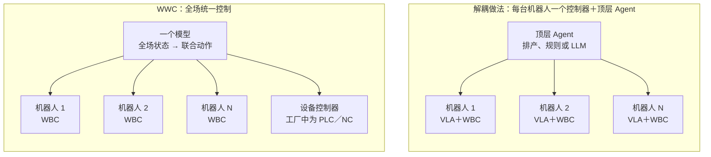

# 00 总览：工厂级世界动作模型

本文件讲两个概念：WWC（Whole World Control，全场统一控制，见 1.3 节）和它在工厂中的实现 FWAM（工厂级世界动作模型，见 2.3 节）。

## 1. 问题从哪里来

### 1.1 单机器人层面：VLA 不直接做全身控制

现有 VLA 大多输出手臂或末端动作，下半身（腿、AGV 底盘）由另一个专门的跟踪控制器执行。几篇代表工作都是这种分层：

| 工作 | 上层（大脑） | 下层（小脑） | 接口 |
|---|---|---|---|
| π0.5 [arXiv 2504.16054] | 同一模型先预测高层语义子任务，再输出低层动作 | 机器人自身控制器 | 动作块 |
| GR00T N1 [arXiv 2503.14734] | System 2：视觉语言模块理解环境与指令 | System 1：扩散 Transformer 实时生成动作 | 两者端到端联合训练 |
| NaVILA [arXiv 2412.04453] | VLA 生成语言形式的中层动作，如"向前 75 cm" | 视觉运动 RL 策略控制腿 | 中层语言动作 |
| LeVERB [arXiv 2506.13751] | 视觉语言策略学习潜在动作词表 | RL 训练的 WBC 策略 | 潜在"动词" |
| Being-0 [arXiv 2503.12533] | 基础模型做规划 | 运动与操作技能库 | 轻量 VLM 作为 Connector |
| HOVER [arXiv 2410.21229] | — | 多模式统一的全身控制器 | 根速度、关节角等多种命令模式 |

LeVERB 的摘要直接指出：多数 VLA 系统假设有一个精确的低层控制器，带手工设定的动作"词表"，如末端位姿或根速度。WBC（全身控制）就是在这个背景下被强调的：它把下层的跟踪器做成通用的，向上层暴露一个统一端口。人形机器人上，这一层常用运动跟踪来训练：

- SONIC：模型 1.2M–42M 参数，700 小时动捕数据，2.1 万 GPU 小时 [arXiv 2511.07820]；
- GMT [arXiv 2506.14770]、BeyondMimic [arXiv 2508.08241]、AMO [arXiv 2505.03738]。

### 1.2 把同样的分层放大到整厂

你的类比可以直接延伸：

| 层级 | 单个人形或轮臂 | 整个工厂 |
|---|---|---|
| 小脑 | 腿或 AGV 的跟踪控制器（WBC） | 每台机器人自己的"VLA＋WBC"，以及每台机床的 PLC／NC |
| 大脑 | VLA，给出手臂动作和底盘目标 | 整厂层：给每台机器人和机床分配任务、路径、时机，并预测结果 |
| 端口 | 根速度、末端位姿、潜在动作 | 技能调用、目标位姿、工位指令、设备命令 |

于是在整厂层面，每台机器人的 VLA 或技能策略退成"子级"，就像单机器人中的 WBC 退成小脑。整厂层需要一个模型：输入全厂状态和所有子级的候选动作，预测全厂接下来会怎样，并据此选动作。这正是 world action model（WAM）在多主体、多时间尺度上的推广。

这种放大方式里，每台机器人仍保留自己的"大脑"（VLA）和"小脑"（WBC），整厂层负责分配和协调，属于下面 1.3 节所说的解耦做法。1.3 节的 WWC 把统一控制的边界再往上推一级。

### 1.3 WWC：比 WBC 高一级的全场统一控制

2026-11-27 提出。WWC 这个概念来自本项目；下面的形式化、对照和适用条件是本目录的整理，尚未经实验验证。

**定义**：WWC（Whole World Control，全场统一控制）指对一个场景中的全部机器人做统一控制。这里的 World 指一个有边界的局部世界，例如一座工厂、一家餐厅、一间咖啡馆或一层办公室，不是世界模型里的"世界"。

WBC 把一台机器人的腿、躯干、手臂和手放进同一个控制器，取代"各部位各有控制器、上层再协调"的做法。WWC 把同样的思路再往上推一级：场景里的多台机器人，以及可以由程序控制的设备，由同一个控制器统一控制，取代"每台机器人一个控制器、上层再用一个 Agent 分配和协调"的解耦做法。

| 层级 | 统一控制的对象 | 统一之前的做法 | 输出 | 时间尺度 |
|---|---|---|---|---|
| 关节控制 | 一个关节 | — | 力矩或电流 | 毫秒级 |
| WBC，全身控制 | 一台机器人的全部关节 | 腿、手臂各有控制器，上层协调 | 全身关节目标或力矩 | 毫秒到秒 |
| WWC，全场统一控制 | 一个场景中的全部机器人与可控设备 | 每台机器人一个控制器，上层 Agent 分配任务 | 每台机器人 WBC 的命令，以及设备命令 | 秒到小时，多时间尺度 |

WWC 不直接输出关节量。每台机器人的 WBC 仍负责把命令变成关节动作，就像 WBC 下面仍然有关节伺服。WWC 上面可以有目标输入（工单、订单或语言指令），但目标是给整个场景的：分给哪台机器人、每台怎么动，都在 WWC 内部决定。

**形式化（供讨论）**：设场景中有 N 台机器人、M 台可控设备，g 是给整个场景的目标。

- 解耦做法：顶层 Agent 给每台机器人分配任务 `z^i = Agent(o_≤t, g)`，机器人 i 用自己的策略执行 `a_t^i ~ π_i(· | o_t^i, z^i)`，只看自己的观测。
- WWC：一个控制器读取全场观测，一次给出联合动作 `(a_t^1, …, a_t^N, d_t^1, …, d_t^M) ~ π_W(· | o_≤t, g)`。`a^i` 送到机器人 i 的 WBC 命令端口（根速度、末端位姿、夹爪或潜在动作），`d^j` 送到设备 j 的控制器。

联合动作的后果（会不会相撞、谁在等谁、交接能否成功）要先预测，才能选动作，所以 WWC 的实现通常要配一个场景级的世界模型：用它给候选联合动作打分（如 MA-WAM [arXiv 2609.31281]），或在模型里训练策略。WAM 联合预测未来状态与动作 [arXiv 2605.12090]，把它用在一个场景上，就是 WWC 的一种实现。

**与已有做法的对照**：

| 做法 | 协调由谁完成 | 执行时各机器人 | 代表工作 | 与 WWC 的关系 |
|---|---|---|---|---|
| 解耦：单机控制＋顶层 Agent | 顶层 Agent（排产、规则或 LLM）拆分并分配任务 | 各用自己的策略执行 | RoboOS：大脑模型做全局决策，小脑技能库执行技能 [arXiv 2505.03673]；RoboOS-NeXT：高层大脑模型做全局规划，各机器人的底层控制器在本地执行，在餐厅、超市和家庭任务上做了实验 [arXiv 2510.26536]；COHERENT：集中的任务分配器把子任务分给各机器人执行器 [arXiv 2409.15146]；SMART-LLM：LLM 完成任务分解、组队和分配 [arXiv 2309.10062]；工厂里的"排产＋各机器人程序" | WWC 要取代的做法 |
| 分散式多智能体 | 训练时用全局信息学习协作 | 每台机器人一个策略，只看局部观测 | QMIX：集中训练分散执行的策略 [arXiv 1803.11485]；FMAPPO：工厂中分散式的多机器人分工与导航 [P39] | 训练时集中、执行时分散，不是 WWC |
| 联合决策、分别执行 | 上层用世界模型预测联合动作的后果，决定分配和时机 | 各机器人的技能策略执行 | L11 中"端口化子级"的做法（形态 A、B 只搜索派工时） | 决策统一，执行不统一 |
| 联合控制 | 一个模型读取全场共享状态 | 同一模型同时输出每台机器人的动作 | World Dreamer v5-lite：共享世界状态，每台机器人一个查询，动作流分开 [arXiv 2610.37518] | 最接近 WWC 的已有工作，只在共享工作台上验证 |
| 联合控制＋设备 | 同上，设备命令也进入联合动作 | 机器人的 WBC、设备的 PLC／NC 执行 | 工厂中的 FWAM（本目录提出，尚无实现） | WWC 在工厂中的形态 |

有两类工作容易和 WWC 混淆：

- 跨本体 WBC：X-WBC 用 9 个仿真本体和 4 台真实机器人的数据联合训练全身控制基础模型 [arXiv 2609.15213]；XHugWBC 一次训练的单个策略在 12 个仿真人形和 7 台真实人形上测试 [arXiv 2602.05791]。它们让一个 WBC 策略能用在多种机器人身体上，每次仍只控制一台机器人。
- 多台机器人用同一份模型权重：每台机器人各自推理、各自决策，仍是逐台控制。WWC 的关键是一次推理同时决定全部机器人的动作。

**适用场景**：WWC 更适合工厂、餐厅、咖啡馆、办公室这类制造和服务场景。下表是本目录对原因的整理（分析判断）：

| 条件 | 工厂 | 餐厅、咖啡馆 | 办公室 |
|---|---|---|---|
| 场景有边界，机器人和设备数量有限，布局已知，可以建数字孪生 | 车间、产线 | 后厨与前厅 | 一层楼或一栋楼 |
| 机器人之间耦合紧：共用通道和资源，有交接 | 共用通道、机床和料架；机器人给机床上下料 | 出餐口和窄通道；做好的饮品交给送餐机器人 | 走廊、电梯和门禁 |
| 连续运行、不复位，前一单影响后一单 | 工单 | 订单 | 配送请求 |
| 有可控设备 | 机床（PLC／NC）、输送线 | 咖啡机、炉灶、洗碗机 | 电梯、门禁 |
| 有局域网和本地算力，集中控制的时延可控 | 车间网络 | 店内网络 | 楼宇网络 |

HolidayFactory 也指出，工业作业由一连串工单组成，前一单的结果会影响后面的作业 [arXiv 2611.11789]。相反，场景很大、机器人之间耦合弱（如城市配送），机器人分属不同所有者、无法共享状态，或通信不稳定时，解耦或分散做法的代价更低（分析判断）。

还要看到另一面：在 LLM 任务规划这一层，[arXiv 2309.15943] 比较了集中式、分散式和两种混合的通信框架，发现混合框架的任务成功率更高，随智能体数量增加也扩展得更好。全部集中不一定最好；WWC 在控制层面能带来多少收益，要用实验回答。

**代价与待验证的问题**（分析判断）：

1. **联合动作的规模**：机器人越多，联合动作越难搜索和学习，要用能分解的结构，例如共享状态加每台机器人一个查询 [arXiv 2610.37518]，或让各智能体置换等价、各自可控的编码（Gamma-World [arXiv 2605.28816]）。
2. **主体数量会变**：机器人和设备会增加、停机、维修，模型要能处理数量变化。
3. **单点故障与通信时延**：中心控制器或网络出问题时全场受影响；每台机器人要保留本地的安全行为，如 WBC 的安全停止和设备互锁。
4. **数据**：需要多台机器人的联合数据，比单机数据难得。单人在智能体辅助下采集多臂数据（HATS [arXiv 2606.16491]）、单人 VR 遥操作两台移动操作机器人（GHOST [arXiv 2608.29080]）和仿真生成（ScheduleGen [arXiv 2610.39429]）可以降低成本。
5. **局部世界取多大**：统一控制的范围越大，越难维持控制频率。一种可能是多速率：同一工位内紧耦合的机器人高频联合控制，相距远、只通过物料和通道耦合的部分按事件低频决策，二者共享同一个状态。范围怎么划，要用实验回答。
6. **安全**：一个控制器同时给多台机器人发命令，上线前要按工业机器人安全标准（ISO 10218-1／-2:2025）做风险评估；本目录没有核对标准条文。

**工厂中的 WWC：FWAM**。工厂中的 WWC 称为 FWAM（工厂级世界动作模型，Factory World Action Model），即用一个世界动作模型实现工厂的全场统一控制，定义见 2.3 节。与餐厅、咖啡馆、办公室相比，工厂中的 WWC 还要处理三类东西：

- 设备逻辑：机床的 PLC／NC 模式与互锁，设备命令进入联合动作；
- 生产流：工单、物料和节拍，时间尺度到小时；
- 加工过程：加工时长、质量与报废，见[专题：形变、流体、断裂与加工](../专题_形变流体断裂与加工/README.md)第 4 节。

服务场景中的 WWC 可以按场景另起名字；本目录只定义工厂中的 FWAM。

## 2. 这个概念已经有名字了吗

### 2.1 已定义的相关术语

- **World Action Model（WAM）**：已有正式定义。综述 "World Action Models: The Next Frontier in Embodied AI" [arXiv 2605.12090] 把 WAM 定义为"统一预测状态建模与动作生成、目标是未来状态与动作的联合分布"的具身基础模型。另一篇综述 [arXiv 2609.16074] 也用这个名字。
- **分层 WAM 是公认的开放问题**：同一篇综述 [arXiv 2605.12090] 写道，把高层语义任务分解与低层物理预测连接在统一可学习架构中的分层世界—动作建模框架，仍是关键的开放挑战。它提出三条路径：一是模块化分层，WAM 作为低层执行器、由高层规划器指挥；二是内在分层 WAM，同时生成粗粒度和细粒度的预测；三是扩展时间上下文。
- **多机器人 WAM 已有初步工作**：
  - World Dreamer v5-lite [arXiv 2610.37518] 是多机器人 WAM：在工作空间坐标中建立共享世界状态，每台机器人一个查询，各自输出动作流。它在 RoboFactory 上平均成功率 74.0%，在 4 个真实机器人任务上 78.8%，但都是共享工作台的协作操作。
  - MA-WAM [arXiv 2609.31281] 用世界模型在测试时评估多智能体的联合动作，但只在 MAMuJoCo、SMAC、MPE 等仿真基准上验证。
  - MAPF-World [arXiv 2508.12087] 是多智能体路径规划的动作世界模型。
- **车队级预测模型**：DeepFleet [arXiv 2508.08574] 在 Amazon 仓库数十万台机器人的运动数据上训练车队基础模型，比较了四种结构，参数从 13M 到 900M。它只预测移动机器人的交通，评审指出它停在预测，没有测试规划效果。
- **大脑—小脑的多机器人框架**：RoboOS [arXiv 2505.03673] 和 RoboOS-NeXT [arXiv 2510.26536] 采用大脑—小脑分层：云端大脑模型做任务分解与分配，分布式小脑执行技能，并有共享记忆。但大脑是 LLM 规划器，不是预测动作后果的世界模型。
- **工业控制中的"整厂控制"**：化工领域的 plantwide control 研究整厂的控制结构，按时间尺度分层：排产以周计，全厂优化以天计，局部优化以小时计，监督控制（MPC）以分钟计，调节控制以秒计 [Skogestad 2004，见下文链接]。这和"整厂世界动作模型"要解决的分层问题高度对应，但那里没有学习式世界模型。

### 2.2 检索结论

截至 2026-11-20，我检索到的文献里：

- **没有**一篇提出"整厂级"世界模型或世界动作模型，即同时预测多台异构机器人、机床设备状态和生产流的模型。
- 最接近的是上面几类：多机器人 WAM 只覆盖单个共享工作台；车队模型只有移动机器人的交通；大脑—小脑框架没有预测；plantwide control 没有学习。
- 有工业界人士使用"工业世界模型""过程世界模型"等说法，但都指单个工艺或设备，不是整厂。

所以，**"整厂级世界动作模型"目前没有被定义的说法**，可以作为一个新概念提出。下面给出几个候选命名，附上与已有术语的区别。

2026-11-27 为 WWC 补充检索：

- 用 "Whole World Control" 和 "whole-world control" 检索，没有找到机器人控制领域的同名用法。
- 名字相近的是全身控制（WBC）方向的跨本体工作，如 X-WBC [arXiv 2609.15213]、XHugWBC [arXiv 2602.05791]。它们让一个 WBC 策略用于多种机器人身体，每次仍控制一台机器人。
- Google DeepMind 2026-07-30 发布的 Gemini Robotics 2 把全身控制和多机器人协作放在一起介绍，但没有说明多台机器人是由一个模型联合控制，还是各自运行一个模型实例（[博客](https://deepmind.google/blog/gemini-robotics-2-brings-whole-body-intelligence-to-robots/)）。
- 做法上最接近 WWC 的仍是 World Dreamer v5-lite [arXiv 2610.37518]。

所以 **WWC 也可以作为新概念提出**。它和 FWAM 的关系见 2.3 节。

### 2.3 命名候选

**概念层级**：WBC（已有：一台机器人的全身控制）→ WWC（本项目 2026-11-27 提出：一个场景的全场统一控制，见 1.3 节）→ FWAM（WWC 在工厂中的实现：用一个世界动作模型完成）。WWC 说的是控制的范围和组织方式，WAM 说的是模型的形式；FWAM 是二者在工厂中的结合。

下表是工厂中这个模型的命名候选，本目录采用 FWAM。

| 候选名 | 英文缩写 | 侧重点 | 与已有术语的区别 |
|---|---|---|---|
| 工厂级世界动作模型 | Factory World Action Model，FWAM | 直接继承 WAM 的定义，范围扩到整厂 | 与 WAM 一脉相承，最易被理解；本目录采用这个名字，工厂中的 WWC 即用此名 |
| 分层车间世界动作模型 | Hierarchical Shop-floor WAM，HS-WAM | 强调分层（整厂层—工位层—机器人层） | 对应综述中"内在分层 WAM"的开放问题 |
| 车队—设备联合世界动作模型 | Fleet-Equipment WAM | 强调机器人车队和机床设备的联合预测 | 区别于 DeepFleet 只有机器人 |
| 编排世界模型 | Orchestration World Model | 强调预测"编排动作"（派工、路由、时机）的后果 | 动作不是关节量，而是对子级的调用 |
| 工厂小脑—大脑模型 | Factory Cerebrum–Cerebellum WAM | 延续 RoboOS 的大脑—小脑比喻 | 大脑本身是可预测的世界动作模型，而不只是 LLM 规划器 |

**FWAM 的工作定义**（本目录提出，供讨论）：

> FWAM 是 WWC 在工厂中的实现。给定整厂的观测历史 o≤t（多机器人传感器、设备 PLC/NC 信号、工单与物料状态）和整厂目标 g（工单、交期），FWAM 预测未来的整厂状态与事件 p(s_{t+1:t+H}, e_{t:t+H} | o≤t, a_{t:t+H})，并在同一模型或配套规划器中生成全场的联合动作 a_t = (a_t^1, …, a_t^N; d_t^1, …, d_t^M)：N 台机器人的命令送到各自 WBC 或底盘控制器的命令端口，M 台设备的命令送到 PLC／NC；派工、路由和时机是联合动作中时间尺度较慢的部分。联合动作由同一个模型给出，不是由每台机器人的策略各自产生、再由上层 Agent 协调。机器人的 WBC 和设备的 PLC／NC 负责把命令变成关节量或设备动作。

2026-11-20 的初版定义把整厂层动作写成"对各子级的指令、时机和路由"，由子级（机器人的 VLA＋WBC）自己决定怎么执行。按 WWC 修订后，子级只保留 WBC 和 PLC／NC 这一级。初版对应 1.3 节表中的"联合决策、分别执行"，作为过渡形态和对照保留在 L11 中。

和单机器人 WAM 的关键差别：

1. **动作是全场的联合动作，不是关节量**：快的部分是各机器人 WBC 的命令；慢的部分是派工、路由和设备命令，例如"机器人 2 去 CNC-1 上料"，"CNC-1 在 t 时刻启动程序 O1001"。
2. **状态是混合的**：连续量（位姿、温度）、离散量（设备模式、工单状态）和事件同时存在。
3. **多时间尺度**：秒级的机器人动作和小时级的生产流共存。
4. **主体数量可变**：机器人和设备会增加、停机、维修。

## 3. 有限算力下的总体思路

可用算力：几张 RTX 3090／4090（24 GB），加极少量 40 GB／80 GB 卡。以下是根据文献中的算力数据做的推导。

### 3.1 能做什么、不能做什么

| 事项 | 文献中的算力 | 在本算力下 |
|---|---|---|
| 从头训练大视频世界模型 | DreamGen 生成 24 万条样本用 1500 张 L40 约 54 小时 [P65] | 不可行 |
| 微调 VLA | openpi：推理需 8 GB 以上，LoRA 微调需 22.5 GB 以上（RTX 4090），全量微调需 70 GB 以上（A100／H100）（openpi README） | LoRA 微调可行 |
| 小 VLA | SmolVLA 设计为单 GPU 训练、消费级 GPU 或 CPU 部署 [arXiv 2506.01844] | 可行 |
| 腿式和人形运动 RL | Learning to Walk in Minutes：单块工作站 GPU，平地四分钟内 [arXiv 2109.11978]；MuJoCo Playground：两块 RTX 4090 上 G1 平地训练不到 30 分钟 [arXiv 2502.08844] | 可行 |
| 通用运动跟踪大模型 | SONIC 用了 2.1 万 GPU 小时 [arXiv 2511.07820] | 不可行，直接用开源权重 |
| 小 JEPA 世界模型 | LeWorldModel 约 1500 万参数，单 GPU 几小时可训，规划不到 1 秒 [P55] | 可行 |
| 视频＋动作联合扩散 | UWM 在 DROID 上训练 10 万步，用 4 张 A100 共 24 小时 [arXiv 2504.02792] | 勉强可行，需降分辨率 |
| 多智能体世界模型评分 | MA-WAM 在 RTX 3090 上，8 个候选的生成加评分共 428 ms，其中评分 13.4 ms [arXiv 2609.31281] | 可行 |
| 车队交通模型 | DeepFleet 的图—地面模型只有 13M 参数 [arXiv 2508.08574] | 结构可借鉴；没有 Amazon 那样的数据量 |

### 3.2 由此得到的思路

1. **整厂层不做像素预测**。整厂的状态用结构化表示：实体图、事件、设备模式、工单。像素和三维只在工位层或机器人层使用。整厂层模型因此可以很小，在一张 4090 上训练。
2. **子级尽量复用现成模型**：π0.5／openpi、GR00T、SmolVLA 做操作；HOVER、GMT、AMO 等开源 WBC 做全身控制；Nav2 做底盘导航。在本算力下只做 LoRA 微调。
3. **数据主要来自仿真**：L1、L2、L4 搭起来的数字孪生可以低成本大量生成"整厂状态—整厂动作—结果"数据。这是整厂层模型的主要数据源。
4. **整厂层可以是"学习式代理＋显式仿真校核"**：学习式模型负责快速搜索候选方案，显式仿真只对少数候选做精确验证。
5. **先在两到三个工位的缩小版工厂上做通**，再加机器人和设备。
6. **WWC 可以分步做**：先搭解耦基线和"联合决策、分别执行"，再逐步把各机器人的动作生成收进同一个模型，每一步都与解耦基线比较（见 L11 第 3 节）。

## 4. 各链路在 FWAM 分层结构中的位置

| 层 | 时间尺度 | 作用 | 对应链路 | 在 WWC 中的位置 |
|---|---|---|---|---|
| 整厂层（大脑） | 分钟到小时 | 派工、路由、排产；预测吞吐、拥堵、设备事件 | L4（离散事件与 PLC）、L11（学习式 FWAM）、L9（潜变量控制，用于整厂层动作） | WWC 中时间尺度较慢的部分：派工、路由、设备命令 |
| 工位层 | 秒到分钟 | 单个工位内的多机器人与设备协作；预测上下料、装夹、加工完成 | L1、L2、L6、L8 | WWC 中时间尺度较快的部分：同一工位内多台机器人的联合动作 |
| 机器人层（小脑） | 毫秒到秒 | VLA 加 WBC；预测接触与几何 | L7、L10（数据与评估）、L1 中的 MPC、L8（INTACT 式无搜索控制，只在仿真中验证过） | WBC 是 WWC 命令的执行端口；解耦做法中的单机 VLA，在 WWC 里由统一模型取代 |
| 资产与数据层 | 离线 | 提供场景、资产、仿真数据 | L1、L2、L3 | 为 WWC 提供场景、资产和数据 |

按 WWC，整厂层和工位层属于同一个控制器的两个时间尺度；局部世界取多大，见 1.3 节第 5 个问题。

形变、流体、断裂和材料去除不单列为一层或一条链路。它们是各层任务可能涉及的条件，任务涉及时各链路要补的能力见[专题：形变、流体、断裂与加工](../专题_形变流体断裂与加工/README.md)；工位层的加工时长、质量和报废概率由专题第 4 节的加工代理提供。

L11 文件夹详细写了怎样把这些层串起来。

## 5. 推荐文献（总览层）

概念与综述：
- World Action Models: The Next Frontier in Embodied AI，[arXiv 2605.12090](https://arxiv.org/abs/2605.12090)：WAM 的正式定义；把分层 WAM 列为开放问题
- World-Action Models for Robot Learning and Control: A Survey，[arXiv 2609.16074](https://arxiv.org/abs/2609.16074)
- From World Models to World Action Models: A Concise Tutorial for Robotics，[arXiv 2607.00836](https://arxiv.org/abs/2607.00836)
- Embodied Intelligence for Flexible Manufacturing: A Survey，[arXiv 2602.06966](https://arxiv.org/abs/2602.06966)：从"工业之眼、工业之手、工业之脑"三层综述制造业具身智能
- Robots Need More than VLA and World Models，[arXiv 2606.06556](https://arxiv.org/abs/2606.06556)：立场论文
- Skogestad, Control structure design for complete chemical plants, Computers & Chemical Engineering 28 (2004) 219–234，[作者 PDF](https://skoge.folk.ntnu.no/publications/2004/control_structure_design_cce/cce04_skogestad.pdf)：整厂控制的分层思想

多机器人与车队：
- World Dreamer v5-lite，[arXiv 2610.37518](https://arxiv.org/abs/2610.37518)
- MA-WAM，[arXiv 2609.31281](https://arxiv.org/abs/2609.31281)
- MAPF-World，[arXiv 2508.12087](https://arxiv.org/abs/2508.12087)
- DeepFleet，[arXiv 2508.08574](https://arxiv.org/abs/2508.08574)
- Gamma-World：多智能体生成式世界模型，[arXiv 2605.28816](https://arxiv.org/abs/2605.28816)
- RoboOS，[arXiv 2505.03673](https://arxiv.org/abs/2505.03673)；RoboOS-NeXT，[arXiv 2510.26536](https://arxiv.org/abs/2510.26536)
- ROSA：机器人工厂的基础模型服务系统，[arXiv 2607.01088](https://arxiv.org/abs/2607.01088)
- Learning While Deploying：16 台双臂机器人车队的在线强化学习，[arXiv 2605.00416](https://arxiv.org/abs/2605.00416)
- RoboFactory [P13]、FMAPPO 多机器人上下料 [P39]、AWMP 排产世界模型 [P38]

全场统一控制（WWC）与解耦做法：
- World Dreamer v5-lite、Gamma-World、RoboOS／RoboOS-NeXT：见上；World Dreamer v5-lite 是最接近 WWC 的已有工作，RoboOS-NeXT 是解耦做法在餐厅、超市和家庭任务上的代表
- COHERENT，[arXiv 2409.15146](https://arxiv.org/abs/2409.15146)：集中的任务分配器加各机器人执行器
- SMART-LLM，[arXiv 2309.10062](https://arxiv.org/abs/2309.10062)：LLM 完成任务分解、组队和分配
- Scalable Multi-Robot Collaboration with Large Language Models: Centralized or Decentralized Systems?，[arXiv 2309.15943](https://arxiv.org/abs/2309.15943)：集中式、分散式与混合框架的比较
- QMIX，[arXiv 1803.11485](https://arxiv.org/abs/1803.11485)：集中训练、分散执行
- X-WBC，[arXiv 2609.15213](https://arxiv.org/abs/2609.15213)；XHugWBC，[arXiv 2602.05791](https://arxiv.org/abs/2602.05791)：跨本体 WBC，与 WWC 的区别见 1.3 节
- Gemini Robotics 2（Google DeepMind 博客，2026-07-30），[链接](https://deepmind.google/blog/gemini-robotics-2-brings-whole-body-intelligence-to-robots/)

VLA 与 WBC 分层：
- π0.5 [arXiv 2504.16054](https://arxiv.org/abs/2504.16054)；GR00T N1 [arXiv 2503.14734](https://arxiv.org/abs/2503.14734)；Hi Robot [arXiv 2502.19417](https://arxiv.org/abs/2502.19417)；HAMSTER [arXiv 2502.05485](https://arxiv.org/abs/2502.05485)
- NaVILA [arXiv 2412.04453](https://arxiv.org/abs/2412.04453)；LeVERB [arXiv 2506.13751](https://arxiv.org/abs/2506.13751)；Being-0 [arXiv 2503.12533](https://arxiv.org/abs/2503.12533)
- HOVER [arXiv 2410.21229](https://arxiv.org/abs/2410.21229)；SONIC [arXiv 2511.07820](https://arxiv.org/abs/2511.07820)；GMT [arXiv 2506.14770](https://arxiv.org/abs/2506.14770)；BeyondMimic [arXiv 2508.08241](https://arxiv.org/abs/2508.08241)；AMO [arXiv 2505.03738](https://arxiv.org/abs/2505.03738)；ASAP [arXiv 2502.01143](https://arxiv.org/abs/2502.01143)
- BEHAVIOR Robot Suite：轮式双臂全身操作 [arXiv 2503.05652](https://arxiv.org/abs/2503.05652)；Mobile ALOHA [arXiv 2401.02117](https://arxiv.org/abs/2401.02117)
